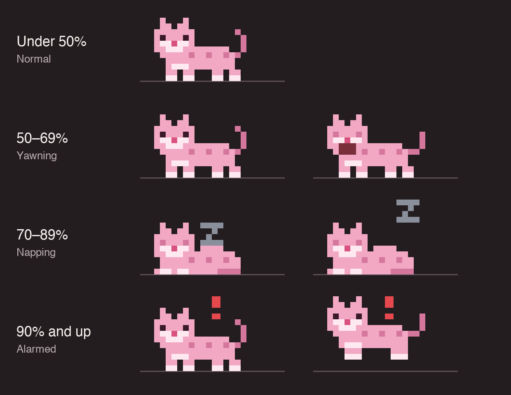
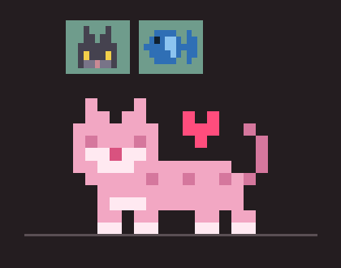
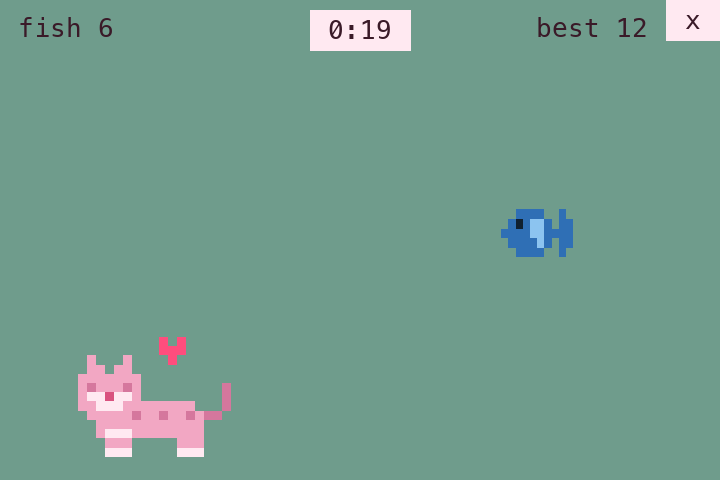

# Cat-Companion

A pixel cat that stands on the message box in the Claude desktop app's Code tab and acts out how full your context window is. Pet it, recolor it, or play a game with it while you wait.



## Install

Made and tested on Claude Code 2.1.331 in the desktop app for Mac. If the cat doesn't appear, update Claude.

At the prompt of a Claude Code terminal session:

```
/plugin install cat-companion --marketplace mightymauls/cat-companion
```

Answer `y` to add the marketplace, then choose a scope. The user scope loads the cat in all your sessions on that computer.

Or from a shell:

```
claude plugin install cat-companion --marketplace mightymauls/cat-companion
```

Or in the Claude desktop app: click **+** next to the prompt box, then **Plugins**, **Add marketplace** with `mightymauls/cat-companion`, then **Add plugin**.

The first time the cat appears, it says thank you in a speech bubble for about 10 seconds. It only happens once.

## What it does

| Context used | The cat |
| --- | --- |
| Under 50% | Blinks and swishes its tail |
| 50–69% | Yawns now and then |
| 70–89% | Curls up and naps |
| 90% and up | Hops up and down under a red "!" |

Below 70%, it also walks in place while Claude works. The percentage is of the model's full context window, so if auto-compact runs first you may not see the later stages.

With reduced motion on, it holds a still pose for each stage. It hides when the window is too small for it, and it does not replace Claude Code's own mascot.

## Pet it

Hover over the cat while Claude is idle: it closes its eyes and floats up hearts. It ignores petting while Claude is working or the alarm is showing.



## Buttons

Hovering also shows two buttons above the cat, even while Claude is working. They go away half a second after your cursor leaves.

| Button | What it does |
| --- | --- |
| Cat face | Switches to the color shown |
| Fish | Starts the game |

## Play catch the fish



Click the fish button, double-click the cat, or type `/cat-game`.

After a three-second countdown, a 30-second timer pops up and a fish swims around. Click the fish and the cat pounces. It gets faster as you catch more, and your best score is kept. Click the x to stop early.

The game pauses while the window is in the background. With reduced motion on, the fish stays still until you click it. The game needs enough room above the message box.

## Commands

| Command | What it does |
| --- | --- |
| `/cat-on` | Shows the cat |
| `/cat-off` | Hides the cat |
| `/cat-color` | Switches to the next color |
| `/cat-color <name>` | Picks a color: orange, pink, black, gray, white, brown or siamese |
| `/cat-game` | Starts the game, or stops it |

Changes apply to the current session right away, and new sessions remember your color, whether the cat is on, and your best score. A hidden cat can't show the context alarm.

## How many tokens does it use?

None to run. The cat runs on your computer and never calls a Claude model. Only typing one of its commands can use any.

| Feature | Tokens |
| --- | --- |
| Sitting there, animating, changing pose | 0 |
| Showing how full your context is: yawning, napping, the alarm | 0: it uses a figure Claude Code already has |
| Estimating context when a session reopens or compacts | 0: Claude Code estimates it on your computer |
| Petting | 0 |
| The one-time thank-you bubble | 0 |
| Changing color with the cat face button | 0 |
| Starting the game with the fish button or a double-click | 0 |
| Playing: timer, clicks, scores | 0 |
| Stopping the game with the x | 0 |
| Remembering your color, on/off choice and best score | 0 |
| `/cat-on` | Up to about 120 each time |
| `/cat-off` | Up to about 120 each time |
| `/cat-color` | Up to about 120 each time |
| `/cat-game` | Up to about 120 each time |

The commands don't make Claude respond, and their replies are marked as for you alone, so Claude doesn't read them. Claude Code may still record the command itself with a short note, which Claude would read along with your later messages until the conversation is compacted or cleared. The command figures are estimates from the length of that text, not exact counts, and can change with Claude Code's version.

## License

Copyright (c) 2026 mightymauls.com. All rights reserved. Cat-Companion is free to install, keep and modify for your own use. Images and videos of the cat, the PDF guide, and links to this repository may be shared, but images, videos and the guide may not be sold or used on products for sale without prior written permission. The mightymauls.com logo may not be used on its own without that permission. The code may not be published, shared, distributed or sold, in original or modified form, without prior written permission. See [LICENSE](LICENSE) for the full terms.

Cat-Companion is an independent mod, not made or endorsed by Anthropic. Claude and Claude Code are Anthropic's.

♥ ♥ ♥ thank you - M.M ♥ ♥ ♥

♥ ♥ ♥ mod by [mightymauls.com](https://mightymauls.com) ♥ ♥ ♥
